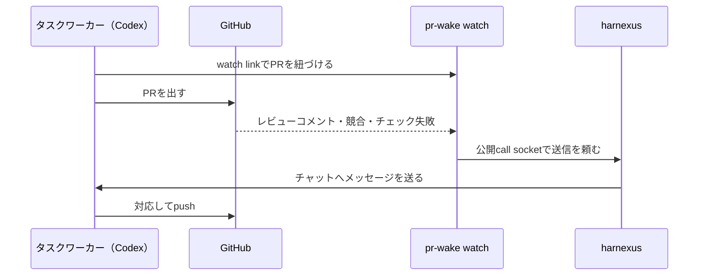
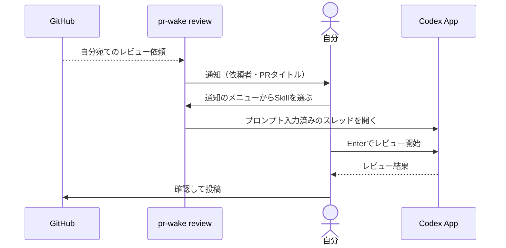

# pr-wake

GitHubのPRで起きたことを知らせる、macOS用の常駐ツール。
`watch`と`review`は別々に常駐し、片方だけでも使える。
コマンドの一覧は`pr-wake watch`・`pr-wake review`で表示される。

```bash
scripts/install.sh
```

Go 1.24とBun 1.4.4で`pr-wake`と監視エンジン`pr-wake-engine`をビルドし、`~/.local/bin`へ入れる。
`PREFIX=<dir>`を付けると`<dir>/bin`へ入れる。
常駐の登録は変えないので、切り替えは`pr-wake watch install`などで行う。

## watch

AIのタスクワーカーが出したPRにレビューコメント・競合・必須チェックの失敗が起きると、そのワーカーのチャットへ知らせる。
自分がPRを見張って、ワーカーに伝え直す必要がなくなる。



監視の本体は同梱の`pr-wake-engine`で、`pr-wake watch`がその常駐を管理する。
チャットへの送信には[harnexus](https://github.com/riii111/harnexus)の公開call socketを使う。
設定は`~/.config/harnexus/pr-watch.json`、記録は`~/.local/state/harnexus-crew/watch/`を使う。

### 導入

1. harnexusのAppをcall socketを有効にして起動し、`~/.config/harnexus/pr-watch.json`を書く
2. `scripts/install.sh`で`pr-wake`と`pr-wake-engine`を入れる
3. `pr-wake watch install`を実行する。`harnexus-task watch`を常駐させていた場合は、この常駐に置き換わる
4. 送信に使うCodexのチャットで`pr-wake watch sender`を一度実行する。それまでは何も送られない

ワーカーのチャットで`pr-wake watch link <PRのURL>`を実行すると、そのPRが監視される。
別のチャットが監視中のPRは、`--take-over`を付けると引き継ぐ。
T3 Codeのスレッドで実行すると、そのスレッドへはT3 Codeの`t3` CLIで送るので、送信元のチャットは要らない。
`t3`は`HARNEXUS_T3_BIN`、`PATH`、`~/.t3/bin/t3`の順に探す。
T3 Codeのスレッドは送られた時刻を示さないので、持ち主が話しかけた直後でも、ワーカーが動いていなければ送る。
`pr-wake watch status`で監視中のPRと送信元を、`--json`でその元のJSONを表示する。
止まったPRは`pr-wake watch release <PRのURL>`で再開し、`pr-wake watch dry-run`で送る内容を記録を変えずに確かめられる。

## review

自分宛てのレビュー依頼を通知し、選んだSkillでAIのレビューをすぐ始められるようにする。



通知を見送るか放置すると、何も起きない。
レビュー対象のコードはPRのheadに固定した専用worktreeに用意されるので、普段のcheckoutは変わらない。
worktreeは自動で消えないので、不要になったら`git worktree remove`で消す。

### 導入

1. `gh`でGitHubにログインし、alerterを入れる: `brew install vjeantet/tap/alerter`
2. 空のフォルダ`~/review-home`を作り、Codex Appのプロジェクトとして追加する。スレッドはここで開く
3. `config.example.json`を`~/.config/pr-wake/review.json`にコピーし、リポジトリとSkillの選択肢を書く
4. `pr-wake review install`を実行する。初回の通知でmacOSの通知を許可する

`pr-wake review smoke --pr owner/repo#123`で、常駐させずに通知からスレッドを開くまでを試せる。
