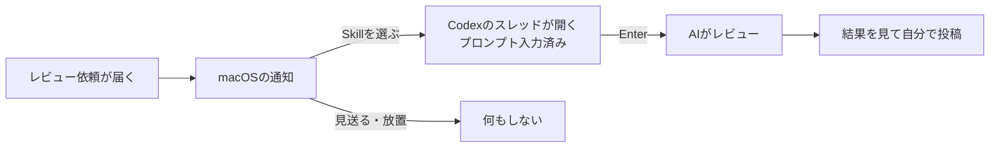
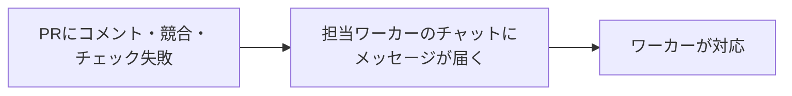

# pr-wake

GitHubのPRで起きたことを知らせる、macOS用の常駐ツール。
`review`と`watch`は別々に常駐し、片方だけでも使える。
コマンドの一覧は`pr-wake review`・`pr-wake watch`で表示される。

```bash
go build -o ~/.local/bin/pr-wake ./cmd/pr-wake
```

## review

自分宛てのレビュー依頼が届くと通知し、選んだSkillでレビューを始められるようにする。



レビュー対象のコードはPRのheadに固定した専用worktreeに用意されるので、普段のcheckoutは変わらない。
worktreeは自動で消えないので、不要になったら`git worktree remove`で消す。

### 導入

1. `gh`でGitHubにログインし、alerterを入れる: `brew install vjeantet/tap/alerter`
2. 空のフォルダ`~/review-home`を作り、Codex Appのプロジェクトとして追加する。スレッドはここで開く
3. `config.example.json`を`~/.config/pr-wake/review.json`にコピーし、リポジトリとSkillの選択肢を書く
4. `pr-wake review install`を実行する。初回の通知でmacOSの通知を許可する

`pr-wake review smoke --pr owner/repo#123`で、常駐させずに通知からスレッドを開くまでを試せる。

## watch

自分のPRにレビューコメント・競合・必須チェックの失敗が起きると、そのPRを作業中のAIタスクワーカーへ伝える。



監視の本体は[harnexus](https://github.com/riii111/harnexus)の`harnexus-task watch`で、pr-wakeはその常駐を管理する。

### 導入

1. harnexusのREADMEに従って`harnexus-task`を入れ、`~/.config/harnexus/pr-watch.json`を書く
2. `pr-wake watch install`を実行する
3. 送信に使うCodexのチャットで`harnexus-task watch --sender`を一度実行する。それまでは何も送られない
