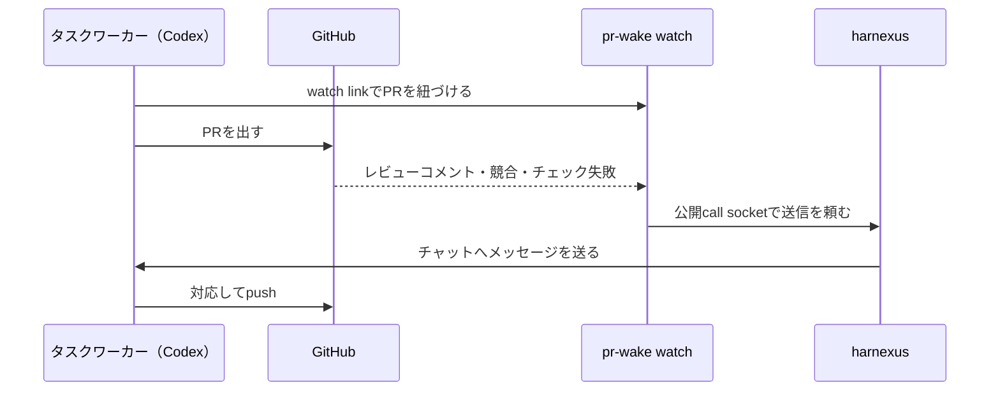
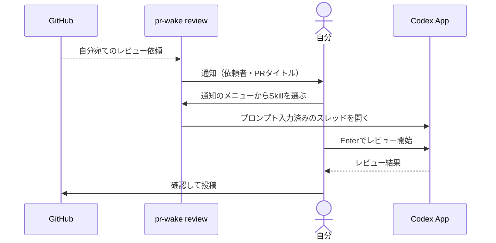

# pr-wake

GitHubのPRの変化を知らせるmacOS用ツール。

- `watch`: PRのレビュー指摘やCIの失敗をAIワーカーへ伝える
- `review`: 自分へのレビュー依頼を通知し、AIによるレビューを始める

それぞれ別に常駐し、片方だけでも使える。

## インストール

Rustと`gh`を用意し、`gh`でGitHubにログインする。

```bash
scripts/install.sh
```

実行ファイルは`~/.local/bin`に入る。

## watch

ワーカーのPRにレビュー指摘、競合、必須チェックの失敗があったとき、担当チャットへ知らせる。
Codex AppとT3 Codeに対応する。



### 導入

1. [harnexus](https://github.com/riii111/harnexus)のcall socketを有効にして起動する
2. `~/.config/harnexus/pr-watch.json`に監視するリポジトリとGitHubアカウントを書く
3. `pr-wake watch install`で常駐を始める
4. Codex Appへ送る場合は、送信元に使うチャットで`pr-wake watch sender`を実行する

設定例:

```json
{
  "repositories": {
    "owner/repo": { "account": "github-user" }
  }
}
```

ワーカーのチャットで`pr-wake watch link <PRのURL>`を実行すると、そのPRの監視が始まる。
T3 Codeのスレッドへは`t3` CLIで送るため、送信元の登録は要らない。

監視状況は`pr-wake watch status`で確認できる。

## review

自分宛てのレビュー依頼を通知し、選んだSkillでAIのレビューを始められる。



### 導入

1. `brew install vjeantet/tap/alerter`でalerterを入れる
2. 空のフォルダ`~/review-home`を作り、Codex Appのプロジェクトとして追加する
3. `config.example.json`を`~/.config/pr-wake/review.json`にコピーし、リポジトリとSkillの選択肢を書く
4. `pr-wake review install`で常駐を始め、初回の通知でmacOSの通知を許可する

`pr-wake review smoke --pr owner/repo#123`で通知からスレッドを開くまでを試せる。
レビュー用のworktreeは自動で消えないため、不要になったら`git worktree remove`で削除する。

コマンドの一覧は`pr-wake watch --help`と`pr-wake review --help`で確認できる。
