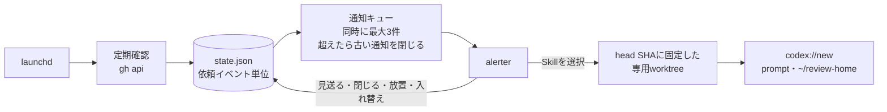

# pr-wake

PRで起きたことを、自分とAIのタスクワーカーへ届ける常駐ツール。macOS専用。

- `pr-wake review`: 自分宛てのGitHubレビュー依頼を通知し、選んだSkillのプロンプトを入力済みのCodexスレッドを開く
- `pr-wake watch`: harnexusの`harnexus-task watch`を常駐させ、各タスクワーカーへ自分のPRのレビューコメント・競合・必須チェックの失敗を伝える

2つは別々の常駐プロセスとして動き、片方だけ止められる。

## 導入

Go 1.24以上で`~/.local/bin`にビルドする。
更新時も同じコマンドでビルドし、使っている機能ごとに`install`をやり直す。

```bash
go build -o ~/.local/bin/pr-wake ./cmd/pr-wake
```

常駐プロセスはビルドした実行ファイルのパスを記録するので、ビルド先を変えたら`install`をやり直す。

## review

レビューするかの判断と送信は自分で行う。



### 動作

**通知**

依頼者・PRタイトル・リポジトリとPR番号を表示し、メニューからSkillを選ぶ。
依頼者が分からない場合は「依頼者不明」と表示する。
別の端末でGitHubの通知を既読にしても届く。
自分宛ての依頼は、`repositories`に書いたownerのリポジトリだけを検索する。
設定にないownerの依頼は届かず、同じownerの未登録リポジトリは通知されて、開始時に理由が表示される。

**重複**

同じ依頼は一度だけ通知する。
同じPRへの再依頼は新しい依頼として通知し、コメントやコミットの追加では通知しない。
初めて起動したときは、その時点の依頼を通知せずに記録だけする。

**見送りと放置**

見送る・閉じる・放置（既定は30分で閉じる）では何も起動せず、同じ依頼を再表示しない。
応答待ちの通知が上限（既定は3件）に達した状態で新しい依頼が届くと、最も古い通知を閉じて新しい依頼を表示する。
閉じた依頼は放置と同じ扱いになる。

**レビューの開始**

Skillを選ぶと、その時点のPRのheadに固定した専用worktreeを作り、Codex Appに新しいスレッドを開く。
スレッドは`~/review-home`で開く。
PRごとにCodexのプロジェクトと信頼確認が増えず、harnexusのレビュアーと同じ場所にまとまる。
`~/review-home`は空のフォルダを作り、Codex Appのプロジェクトとして追加しておく。
レビュー対象のコードはworktreeにあるので、プロンプトに`{{.Worktree}}`で渡す。
プロンプトは入力済みで、Enterを押すとレビューが始まる。
普段のcheckoutのbranch・HEAD・作業中の変更は変わらない。
worktreeは自動で削除しない。
同じheadのworktreeに変更が残っていれば、別のworktreeを作る。

**開始できないとき**

checkoutが設定にない、originが違う、PRを取得できないなどの場合は、理由を通知して何も開かない。
cloneや別のディレクトリでの起動はしない。

**しないこと**

GitHubの通知の既読化、レビュー投稿、Approve、マージは行わない。
モデル・推論の強さ・スレッド名は指定できず、Codex Appの既定値になる。

### 導入

alerterはnix-darwinのHomebrew（`vjeantet/tap/alerter`）で入る。

```bash
mkdir -p ~/.config/pr-wake
cp config.example.json ~/.config/pr-wake/review.json
# review.jsonを編集してから
pr-wake review install
```

`install`は設定・コマンド・GitHub APIを確認し、問題がなければ常駐を始める。
dotfilesのreview-notifierが残っていれば、止めて実行ファイルを消し、設定と通知済みの記録を引き継ぐ。
review-notifierが作ったworktreeは元の場所に残る。
初回の通知時に、macOSでalerterの通知を許可する。

```bash
pr-wake review status     # 常駐の状態と最近の依頼
pr-wake review logs -f    # ログ
pr-wake review stop
pr-wake review start      # 開始、または再起動
pr-wake review uninstall  # 設定・状態・ログ・worktreeは残す
```

### 設定

設定を変えたら`pr-wake review start`で再起動する。
知らない項目があるとエラーになる。

```text
~/.config/pr-wake/review.json              端末ごとの設定（Git管理しない）
├── repositories                           owner/repo → ローカルcheckoutの絶対パス（~/ 可）
├── teams                                  通知するチーム宛て依頼（org/team-slug）。空なら自分宛てだけ
├── pollIntervalSeconds                    確認間隔。既定60、最小30
├── notificationTimeoutSeconds             通知を閉じるまでの秒数。既定1800
├── maxNotifications                       応答待ちで同時に出す通知の数。既定3、最大10
├── worktreeRoot                           worktreeの置き場所。既定 ~/.local/share/pr-wake/worktrees
├── commands                               gh・git・alerter・open・osascriptの絶対パス。省略時は自動で探す
└── choices[]                              通知メニューに並ぶ順の選択肢。追加・削除・並べ替えはここだけで反映
    ├── id                                 英小文字・数字・-
    ├── label                              メニューの表示名（カンマ不可）
    ├── skill                              Skill名。~/.codex/skills/<skill>/SKILL.md が必要
    └── prompt                             渡すプロンプト（Goのtext/template）
        ├── {{.PR.URL}} {{.PR.Title}}      PRのURL・タイトル
        ├── {{.PR.Repo}} {{.PR.Number}}    owner/repo・PR番号
        ├── {{.PR.HeadSHA}}                固定したheadのSHA
        ├── {{.PR.BaseRef}}                baseのブランチ名
        ├── {{.Requester}}                 依頼者（不明なら空）
        ├── {{.Skill}} {{.SkillPath}}      Skill名・SKILL.mdの絶対パス
        └── {{.Worktree}}                  専用worktreeの絶対パス
```

```text
~/.local/state/pr-wake/review/state.json   通知済み・見送りなどの記録。消すと初回起動と同じ扱い
~/Library/Logs/pr-wake/review.log          ログ
~/.local/share/pr-wake/worktrees/          <owner>/<repo>/pr-<番号>-<SHA先頭12桁>（2つ目以降は -2 など）
```

### 試す

常駐させずに、指定したPRで通知からスレッドを開くまでを試せる。
記録は残らない。

```bash
pr-wake review check                                                         # 設定・コマンド・GitHub APIの確認
pr-wake review smoke --pr owner/repo#123 --requester someone
pr-wake review smoke --pr https://github.com/owner/repo/pull/123 --no-open  # 開く代わりにリンクを表示する
```

不要になったworktreeは`git -C <checkout> worktree remove <path>`で消す。

## watch

監視の本体は[harnexus](https://github.com/riii111/harnexus)の`harnexus-task watch`で、pr-wakeは常駐の登録と状態の表示だけを受け持つ。
先にharnexusのcheckoutで`bun run install:task`を実行し、`~/.local/bin/harnexus-task`を入れておく。
設定は`~/.config/harnexus/pr-watch.json`に、harnexusのREADMEに従って書く。
待ち合わせるAIレビューbotは、この設定の`reviewBots`で指定する。

```bash
pr-wake watch install
```

`install`は`harnexus-task watch --dry-run`で設定・ghのアカウント・GitHub APIを確認し、問題がなければ常駐を始める。
dotfilesで登録した常駐（`io.github.riii111.pr-watch`）が残っていれば、止めて置き換える。

メッセージはすべて1つのチャットから送られる。
導入後、送信用に残しておくCodexのチャットで`harnexus-task watch --sender`を一度実行する。
それまでは何も送られない。

```bash
pr-wake watch status                   # 常駐の状態と監視中のPR（harnexus-task watch --statusを読む）
pr-wake watch logs -f
pr-wake watch stop
pr-wake watch start                    # 開始、または再起動
pr-wake watch uninstall                # 設定・状態・ログは残す
harnexus-task watch --dry-run          # 送らずに、送る内容を表示する
harnexus-task watch --link <PR URL>    # 任意のチャットから、そのPRの出来事を受け取るよう登録する
```

ログは`~/Library/Logs/pr-wake/watch.log`に出る。
