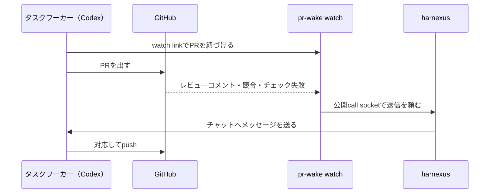
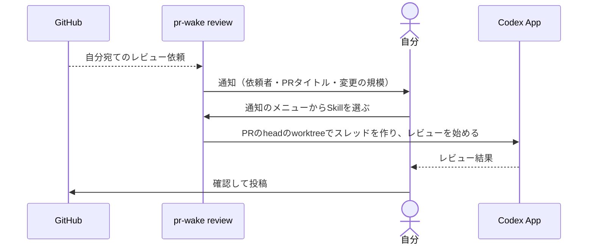

# pr-wake

GitHubのPRの変化を知らせるmacOS用ツール。

- `watch`: PRのレビュー指摘やCIの失敗をAIワーカーへ伝える
- `review`: 自分へのレビュー依頼を通知し、AIによるレビューを始める

それぞれ別に常駐し、片方だけでも使える。

## インストール

Rustと`gh`を用意し、`gh`でGitHubにログインする。

```bash
scripts/install.sh
```

実行ファイルは`~/.local/bin`に入る。

## watch

ワーカーのPRにレビュー指摘、競合、必須チェックの失敗があったとき、担当チャットへ知らせる。
Codex AppとT3 Codeに対応する。



### 導入

1. [harnexus](https://github.com/riii111/harnexus)のcall socketを有効にして起動する
2. `~/.config/harnexus/pr-watch.json`に監視するリポジトリとGitHubアカウントを書く
3. `pr-wake watch install`で常駐を始める
4. Codex Appへ送る場合は、送信元に使うチャットで`pr-wake watch sender`を実行する

設定例:

```json
{
  "repositories": {
    "owner/repo": { "account": "github-user" }
  }
}
```

ワーカーのチャットで`pr-wake watch link <PRのURL>`を実行すると、そのPRの監視が始まる。
T3 Codeのスレッドへは`t3` CLIで送るため、送信元の登録は要らない。

監視状況は`pr-wake watch status`で確認できる。

## review

自分宛てのレビュー依頼を通知し、選んだSkillでAIのレビューを始められる。



### 導入

1. `brew install vjeantet/tap/alerter`でalerterを入れる
2. 空のフォルダ`~/review-home`を作り、Codex Appのプロジェクトとして追加する
3. `config.example.json`を`~/.config/pr-wake/review.json`にコピーし、リポジトリとSkillの選択肢を書く
4. `pr-wake review install`で常駐を始め、初回の通知でmacOSの通知を許可する

通知を押すと、PRをブラウザで開いてから同じ通知をもう一度出す。
既定のブラウザがChromeなどChromium系なら、新しいウィンドウで開く。

選んだレビューは、harnexusでCodex Appにスレッドを作って始める。
スレッドは、リポジトリのクローンを登録したCodex Appのプロジェクトで、PRのheadから作ったworktreeで動く。
そのため次を用意する。

- harnexusのcall socketを有効にする
- `pr-wake watch sender`で送信元のチャットを登録する
- `repositories`に書いたクローンをCodex Appのプロジェクトとして追加する

用意がないなどでスレッドを作れないときは、pr-wakeが作ったworktreeの場所をプロンプトに足してスレッドを開き、Enterで始める。
pr-wakeのworktreeは自動で消えないため、不要になったら`git worktree remove`で削除する。

`pr-wake review smoke --pr owner/repo#123`で通知からレビューを始めるまでを試せる。

以前の`config.example.json`から作った設定は、プロンプトの`{{.Worktree}}`を読み込めず、レビューの常駐が止まる。
更新前に、`{{.Worktree}}`を含む文をプロンプトから消す。

### 再レビュー

pr-wakeが作ったスレッドは、作った時点でPRへ紐づける。
それ以外のスレッドは、そのスレッドで`pr-wake review link <PRのURL>`を実行すると紐づく。
実行はレビュー用のSkillの手順に含める。
`~/.config/pr-wake/review.json`がない環境では紐づけず、エラーで終わる。
自分が作成したPRは紐づけず、`skipped`で始まる行を出して正常に終わる。紐づけたときは`linked`で始まる。

紐づけたPRに再依頼が届くと、通知でSkillを選ばなくても、新しいスレッドを開かず、前回のレビューと同じSkillで、その時点のheadのレビュー依頼をそのスレッドへ送る。
送れたことは通知で知らせる。
前回のレビューの記録がないPRは、通常どおり通知でSkillを選ぶ。

送信にはharnexusのcall socketと、`pr-wake watch sender`で登録した送信元のチャットを使う。
送れなかったときや送れたか分からないときは、前回の文脈と分かれないよう、新しいスレッドを開かずに失敗として通知する。

### まとめてレビューする

設定に`batches`を書くと、依頼が届いても通知せずにためておき、決まった時刻にまとめてレビューを始める。
書かなければ、依頼ごとに通知してSkillを選ぶ。

```json
"batches": {"readyAt": ["11:00", "16:00"], "leadMinutes": 10}
```

- `readyAt`: レビューの結果を読む時刻。Macのタイムゾーンで`HH:MM`と書く
- `leadMinutes`: `readyAt`の何分前にレビューを始めるか。省略すると10分

月〜金の各`readyAt`の`leadMinutes`前に、ためた依頼のレビューを始める。
`readyAt`に「レビュー N件」の通知を1回出し、始めたPRと報告だけにしたPRを並べる。
始められなかった依頼は、従来どおり依頼ごとの失敗の通知も出す。
スリープなどで開始時刻を過ぎたときは、同じ日のうちに気づいた時点で1回だけ始める。
`readyAt`も過ぎていれば、通知は始め終えたときに出す。

始めるか報告だけにするかは、始める時点のレビュアーの人数で決める。
人数は、自分と、指名されている人と、レビューを送った人を数える。
PRの作成者とbotは数えない。

- 自分だけ: レビューを始める
- 2人: レビューを始める。ただし他の人が承認済みなら報告だけにする
- 3人以上: 報告だけにする

レビュアーを読めなかった依頼は、取りこぼさないようレビューを始める。
Skillは、紐づけたPRの再依頼なら前回と同じもの、それ以外は`choices`の先頭を使う。
紐づけたPRの再依頼も同じくためて、時刻になったらそのスレッドへ送る。

`pr-wake review now`で、ためた依頼を同じ基準でその場で始め、始め終えたら通知する。
`pr-wake review now --pr <PRのURL>`は、そのPRだけを人数に関係なく始める。
対象は、ためている依頼か報告だけにした依頼があるPRに限る。
どちらも常駐中のreviewに依頼を渡すだけなので、結果は通知と`pr-wake review logs`で確認する。

`pr-wake review status`では、ためている依頼を`queued`、報告だけにした依頼を`reported`と表示する。

#### GitHubの通知

`batches`を書くと、受け付けたPRのGitHub通知を整理する。
直近30日に受け付けたPRの未読の通知は、スレッドの購読を解除して完了（Done）にする。
自分がレビューを送ると購読が戻るため、その後の通知も同じように整理する。
メンション（reasonが`mention`・`team_mention`）の通知は残す。
整理に失敗してもログに残すだけで、レビューの流れは止めない。

コマンドの一覧は`pr-wake watch --help`と`pr-wake review --help`で確認できる。
